<a href="README.md">Türkçe</a> · <b>English</b>

I build desktop, mobile and web applications. I enjoy shipping things real people use: from telecom software to small business websites, and right now my own product, an employee tracking system. I do my day-to-day work on Linux Mint.

  
  
  
  

#### Projects & experience

<table>
<tr>
<td width="50%" valign="top">
<b>LocTrack</b> &nbsp;<code>in progress</code> 
Employee tracking and management system. Will be released as a paid product.
</td>
<td width="50%" valign="top">
<b><a href="https://cansip.cantelekom.com">CanSIP</a></b> &nbsp;<code>live</code> 
The CanSIP app and the cansip.cantelekom.com website for Can Telekom (designed to match the main corporate site).
</td>
</tr>
<tr>
<td width="50%" valign="top">
<b><a href="https://github.com/noviceWriter/mcpack">mcpack</a></b> &nbsp;<code>open source</code> 
Minecraft modpack manager written in Python. Modrinth / CurseForge support, mrpack / Prism export, server packs.
</td>
<td width="50%" valign="top">
<b>Void Creations</b> &nbsp;<code>past</code> 
Web development for a Roblox fan game team led by Newon.
</td>
</tr>
<tr>
<td width="50%" valign="top">
<b>Student Management System</b> &nbsp;<code>archived</code> 
Built with Flutter / Dart as a school project. Closed source, no longer in use.
</td>
<td width="50%" valign="top">
<b>Credit Ledger (Veresiye Defteri)</b> &nbsp;<code>archived</code> 
C# desktop app running on a local MySQL database. Closed source, no longer in use.
</td>
</tr>
</table>

<b>Client websites:</b>
<a href="https://afyonuyduguvenlik.site/">afyonuyduguvenlik.site</a> ·
<a href="https://afyonyazicitamir.site/">afyonyazicitamir.site</a> ·
<a href="https://afyonuvlazerbaski.shop/">afyonuvlazerbaski.shop</a>

#### Tech stack

<table>
<tr>
<th>Desktop</th><th>Mobile</th><th>Web</th><th>Data & Tools</th>
</tr>
<tr>
<td align="center"></td>
<td align="center"></td>
<td align="center"></td>
<td align="center"> + MSSQL</td>
</tr>
</table>

#### Activity

<picture>
  <source media="(prefers-color-scheme: dark)" srcset="https://raw.githubusercontent.com/noviceWriter/noviceWriter/output/github-snake-dark.svg" />
  
</picture>
