<b>Türkçe</b> · <a href="README.en.md">English</a>

Masaüstü, mobil ve web tarafında uygulama geliştiriyorum. Gerçek kullanıcıya yönelik işler yapmayı seviyorum: telekom yazılımından küçük işletme sitelerine, şu an ise kendi ürünüm olan bir çalışan takip sistemine kadar.

  
  
  
  

#### Projeler ve deneyim

<table>
<tr>
<td width="50%" valign="top">
<b>LocTrack</b> &nbsp;<code>geliştiriliyor</code> 
Çalışan takip ve yönetim sistemi. Ücretli bir ürün olarak yayınlanacak.
</td>
<td width="50%" valign="top">
<b><a href="https://cansip.cantelekom.com">CanSIP</a></b> &nbsp;<code>yayında</code> 
Can Telekom için CanSIP programı ve cansip.cantelekom.com sitesi (ana siteyle uyumlu tasarım).
</td>
</tr>
<tr>
<td width="50%" valign="top">
<b><a href="https://github.com/noviceWriter/mcpack">mcpack</a></b> &nbsp;<code>açık kaynak</code> 
Python ile yazılmış Minecraft mod paketi yöneticisi. Modrinth / CurseForge desteği, mrpack / Prism export, server pack.
</td>
<td width="50%" valign="top">
<b>Void Creations</b> &nbsp;<code>dönemsel</code> 
Newon önderliğindeki Roblox fan oyunu ekibinde web geliştirme.
</td>
</tr>
<tr>
<td width="50%" valign="top">
<b>Öğrenci Yönetim Sistemi</b> &nbsp;<code>arşiv</code> 
Flutter / Dart ile proje ödevi. Kapalı kaynak, aktif kullanımda değil.
</td>
<td width="50%" valign="top">
<b>Veresiye Defteri</b> &nbsp;<code>arşiv</code> 
C# masaüstü, yerel MySQL ile çalışır. Kapalı kaynak, aktif kullanımda değil.
</td>
</tr>
</table>

<b>Müşteri siteleri:</b>
<a href="https://afyonuyduguvenlik.site/">afyonuyduguvenlik.site</a> ·
<a href="https://afyonyazicitamir.site/">afyonyazicitamir.site</a> ·
<a href="https://afyonuvlazerbaski.shop/">afyonuvlazerbaski.shop</a>

#### Teknolojiler

<table>
<tr>
<th>Masaüstü</th><th>Mobil</th><th>Web</th><th>Veri & Araçlar</th>
</tr>
<tr>
<td align="center"></td>
<td align="center"></td>
<td align="center"></td>
<td align="center"> + MSSQL</td>
</tr>
</table>

#### Aktivite

<picture>
  <source media="(prefers-color-scheme: dark)" srcset="https://raw.githubusercontent.com/noviceWriter/noviceWriter/output/github-snake-dark.svg" />
  
</picture>
